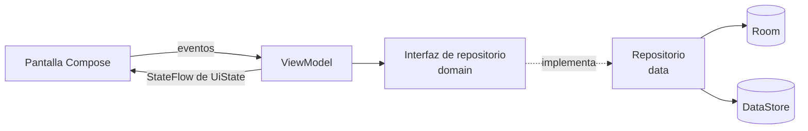

# Arquitectura

MVVM con Clean Architecture pragmática, en un único módulo Gradle `:app` y separada por paquetes. Las capas existen para aislar responsabilidades reales; no se añaden capas que solo reenvíen llamadas.

## Flujo de datos

La base local es la fuente de verdad. La interfaz observa `Flow`: cualquier escritura en Room se refleja sola en las pantallas.

## Paquetes

| Paquete | Responsabilidad | Puede depender de |
|---|---|---|
| `domain/model` | Modelos de negocio en Kotlin puro | Nada de Android |
| `domain/repository` | Contratos de datos | `domain/model` |
| `domain/capture` | Reglas puras de fechas, duplicados, campos vacíos y validación | `domain/model` |
| `domain/usecase` | Reglas que combinan datos. **Se crea solo cuando haya lógica real** | `domain` |
| `domain/priority` | Motor de priorización, transparente y sin efectos secundarios | `domain/model` |
| `domain/tasks` | Vistas, filtros, búsqueda, transiciones de estado y ciclos de dependencias | `domain/model`, `domain/priority` |
| `domain/dashboard` | Indicadores, recomendación del día y alertas | `domain/tasks` |
| `data/local` | Entidades y DAO de Room | `core/database` |
| `data/repository` | Implementación de los contratos | `data/local`, `domain` |
| `core/common` | Utilidades transversales, cuando existan | Nada de `feature` |
| `core/database` | `AppDatabase`, convertidores, siembra, migraciones | `data/local` |
| `core/designsystem` | Tema, tokens y componentes reutilizables | `domain/model` (solo `ThemeMode`) |
| `core/navigation` | Rutas, destinos, `NavHost` y shell | `core/designsystem`, `feature` |
| `core/notifications` | Canales, publicación de avisos, workers y acciones de la notificación | `domain` |
| `domain/reminders` | Horario silencioso, próximas ejecuciones y decisión de qué se notifica | `domain/tasks` |
| `domain/projects` | Avance ponderado, previsión, desviación y retrasos | `domain/priority` |
| `domain/planning` | Bloques, solapamientos, capacidad y plan frente a ejecución | Nada de otras capas |
| `domain/learning` | Objetivos, sesiones y horas por tema y semana | `domain/planning` |
| `domain/reviews` | Preguntas, resumen semanal y sugerencias heurísticas | `domain/tasks`, `domain/planning`, `domain/projects`, `domain/learning` |
| `domain/metrics` | Cálculo de los indicadores y sus periodos | `domain/tasks`, `domain/planning`, `domain/learning` |
| `domain/backup` | Contrato de exportación y restauración | Nada de otras capas |
| `data/backup` | Formato de copia, cifrado, validación y restauración | `data/repository`, `core/database` |
| `feature/*` | Pantalla + ViewModel de cada módulo | `core`, `domain` |
| `di` | Módulos Hilt | Todas las capas |

Reglas:

- `feature` nunca importa `data`. Accede a los datos mediante interfaces de `domain`.
- `domain` no importa Android, Room ni Compose.
- Los paquetes se crean al tener código. No se dejan archivos vacíos para aparentar estructura.

## Inyección de dependencias

Hilt, con tres módulos en `di/`:

| Módulo | Provee |
|---|---|
| `DatabaseModule` | `AppDatabase`, DAO y `java.time.Clock` |
| `DataStoreModule` | `DataStore<Preferences>` con recuperación ante archivo corrupto |
| `RepositoryModule` | Enlaces de interfaz a implementación |

`Clock` se inyecta para que las fechas sean deterministas en las pruebas.

## Navegación

Navigation Compose con rutas tipadas mediante `@Serializable`.

- `ExecutiveOsShell` contiene `NavigationSuiteScaffold` (barra inferior en móvil, riel en pantallas anchas) y el botón **CAPTURAR**.
- Barra: Inicio, Bandeja, Tareas, Proyectos, Más. «Más» abre Planificación, Formación, Revisiones, Métricas y Configuración dentro de un grafo anidado, de modo que la pestaña sigue marcada al entrar en ellas.
- La captura y los editores ocultan la navegación y el botón flotante: son tareas a pantalla completa.

## Persistencia

| Almacén | Contenido | ¿Viaja en copias de seguridad? |
|---|---|---|
| Room | Datos de negocio | Sí, mediante la exportación propia (Fase 6) |
| DataStore | Preferencias del dispositivo: tema, última categoría y proyecto, borrador de captura | No |
| `user_settings` en Room | Pesos y umbrales de prioridad; más adelante, capacidad | Sí |

Detalle del esquema en [DATA_MODEL.md](DATA_MODEL.md).

## Seguridad y privacidad

Controles activos desde Sprint 0:

- El manifiesto **elimina el permiso `INTERNET`** incluso si una dependencia lo declarase. Se verifica sobre la APK generada.
- `allowBackup="false"` y reglas de extracción que excluyen todos los dominios: los datos no salen por copia automática ni por transferencia entre dispositivos.
- Sin SDK de analítica ni de publicidad. Los errores de lectura no se registran en logs.
- `.gitignore` excluye claves, almacenes de firma, `local.properties` y exportaciones.

Controles previstos: cifrado de exportaciones con bibliotecas mantenidas y Android Keystore cuando sea necesario (Fase 6). No se implementa criptografía propia.

## Preparación para integraciones futuras

Gmail, Calendar, Outlook y la sincronización llegarán como nuevas implementaciones en `data` detrás de contratos en `domain`, y requerirán reintroducir `INTERNET` de forma explícita. Cualquier integración con Google usará OAuth 2.0, API oficial, permisos mínimos y consentimiento explícito; nunca se almacenarán contraseñas de cuentas externas.

## Cómo añadir un módulo

1. Modelo y contrato en `domain`.
2. Entidad, DAO e implementación en `data`; registrar la entidad en `AppDatabase`, subir `SCHEMA_VERSION` y declarar su **migración con prueba** (`AutoMigration` si es aditiva).
3. Enlace en `RepositoryModule`.
4. `feature/<modulo>` con pantalla, ViewModel y `UiState`.
5. Sustituir su `PendingSection` en `AppNavHost` por la pantalla real.
6. Pruebas según [TEST_PLAN.md](TEST_PLAN.md) y actualización de la documentación.

## Compilación

| Elemento | Valor |
|---|---|
| Gradle / AGP | 9.6.0 / 9.5.1, con Kotlin integrado y DSL nuevo |
| Kotlin / KSP | 2.4.21 / 2.3.13, sin kapt |
| SDK | min 29, target 36, compile 37 |
| JDK | JBR 21 para ejecutar Gradle, bytecode 17 |

`gradle.properties` limita el heap a 2,5 GB, compila Kotlin dentro del proceso de Gradle y usa dos workers, para que el proyecto sea viable en equipos de 8 GB.
